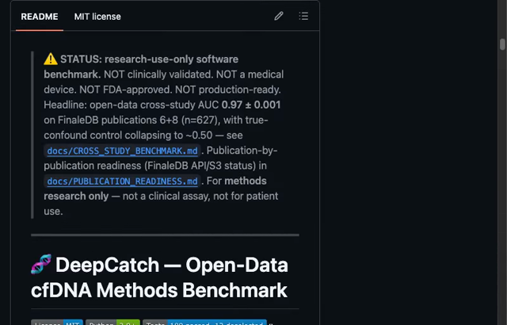
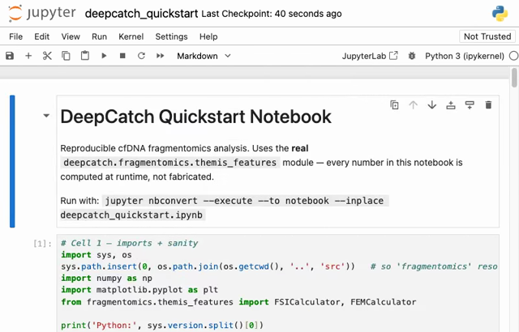
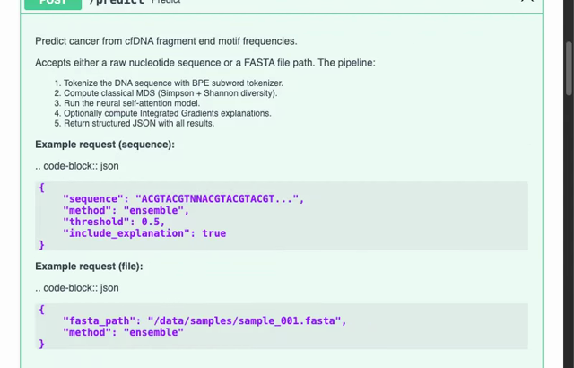
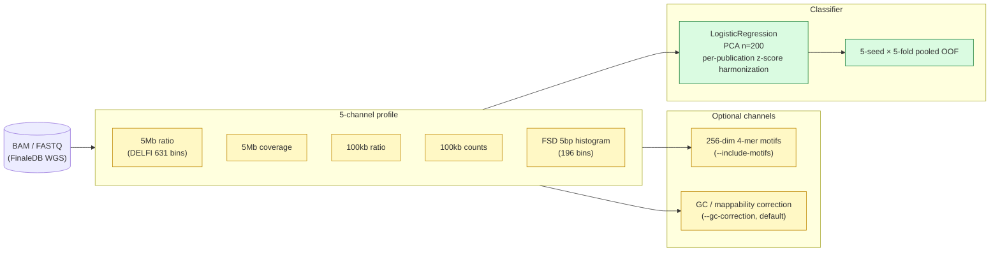

> **⚠️ STATUS: research-use-only software benchmark.** NOT clinically validated. NOT a medical device. NOT FDA-approved. NOT production-ready.
> Headline: open-data cross-study AUC **0.9684 ± 0.0027** on FinaleDB publications 6+8 (n=627) with default GC correction (legacy baseline 0.9770 is inflated by ~0.009 of GC-axis proxy detection; both numbers reported in the table below). True-confound control collapses to ~0.48 — see [`docs/CROSS_STUDY_BENCHMARK.md`](docs/CROSS_STUDY_BENCHMARK.md).
> Publication-by-publication readiness (FinaleDB API/S3 status) in [`docs/PUBLICATION_READINESS.md`](docs/PUBLICATION_READINESS.md).
> External validation on held-out public publications (never trained on): **AUC 0.9444** [0.8731, 1.0] on FinaleDB publication 7 (WGS, n=31), 0.708 on publication 1 (WGS, n=52), 0.7385 pooled over the publications carrying both classes. Transfer between whole-genome studies is real but far from uniform. The pooled 0.968 is a *within-cohort* number — leave-one-study-out gives 0.6805. See [`docs/EXTERNAL_VALIDATION.md`](docs/EXTERNAL_VALIDATION.md).
> For **methods research only** — not a clinical assay, not for patient use.

---

# 🧬 DeepCatch — Open-Data cfDNA Methods Benchmark

[](LICENSE)
[](https://www.python.org/)
()
[](results/)
[](MODEL.md)
[](https://rollroyces.github.io/deepcatch/)
[](ULTRA_EARLY_READINESS.md)

**DeepCatch** is an open-source computational framework for multi-cancer early detection (MCED) from cell-free DNA (cfDNA). It combines tumor-informed mutation panels with a tumor-naive fragmentomics channel, tracks patients longitudinally with Bayesian Kalman filtering, and predicts tissue-of-origin — a two-stage CET (Capture → Enhance → Triage) pipeline.

**Manuscripts:** [`paper.md`](paper.md) (JOSS format) · [`paper/METHODS_PAPER.md`](paper/METHODS_PAPER.md) (long-form methods) · [`paper/paper.tex`](paper/paper.tex) (preprint source, compiled by CI) — submission guide in [`paper/README.md`](paper/README.md).

---

## 🤝 Seeking wet-lab collaborators for external cohort validation

**This project has the analysis pipeline; it does not have the clinical plasma.** Everything published here runs on public data (FinaleDB, TCGA, GEO) and therefore cannot say anything about performance on a real screening population. If you run cfDNA sequencing and have a cohort with cancer/control labels, **you are exactly the collaborator this project needs** — and the analysis side is already built, validated and open source.

What is already in place, so a collaboration starts from a working baseline rather than from scratch:

| Piece | State |
|---|---|
| 5-channel DELFI feature extractor (5 Mb / 100 kb ratios + coverage, FSD-196) | ready, self-contained (`src/fragmentomics/finale_features.py`) |
| Cross-study benchmark with per-study harmonization and two confound controls | ready (`scripts/cross_study_finallydb.py`) |
| Leave-one-study-out transfer measurement | ready (`scripts/cross_study_loso.py`) |
| Public external-cohort fetcher (no IRB, no data-use agreement) | ready (`scripts/fetch_external_cohort.py`) |
| Mutation-panel LLR with CADD / AlphaMissense weighting | ready (real TCGA-LUAD, AUC 0.921 @ 0.1% ctDNA) |
| Regularized late fusion / Bayesian model averaging | ready (`src/foundation/regularized_fusion.py`) |

**What a collaborator contributes**: the cohort (plasma + labels + stage), and the clinical interpretation. **What we contribute**: feature extraction, harmonization, the statistical protocol (DeLong CIs, sens@spec grids, PPV at screening prevalence, leave-one-cohort-out), and the code.

Scope that would be useful, in order of what unblocks the most:

1. **Unpaired plasma, cancer + non-cancer** (any tumour type) — enough to run the same external-validation protocol as the public cohort.
2. **Serial draws** (the same patient over time) — this is what the longitudinal Stage-2 tracker cannot be evaluated on at all right now.
3. **Stage I vs late-stage labels** — the stage breakdown is implemented and waiting for data.
4. **Matched tumour tissue** — enables tumour-specific fragmentomics instead of tumour-agnostic ones.

Everything is MIT-licensed and every number in the repository traces to a committed JSON artifact, so a collaborator can audit the analysis end to end before deciding anything. See [`TEAM.md`](TEAM.md) §2 for the contribution model, [`CONTRIBUTING.md`](CONTRIBUTING.md) for how to set the project up, run the tests and bring a cohort in, and [`docs/PRODUCTION_ROADMAP.md`](docs/PRODUCTION_ROADMAP.md) for the validation plan.

**How to reach us**: open a *External cohort validation (collaboration)* issue — the template asks for cohort metadata only, so no patient data ever has to leave your institution. Questions about the analysis itself are better in [Discussions](https://github.com/rollroyces/deepcatch/discussions). Code contributions are governed by [`CONTRIBUTING.md`](CONTRIBUTING.md) and [`CODE_OF_CONDUCT.md`](CODE_OF_CONDUCT.md).

---

## Demo (3 real browser recordings)

Three real GUI demos recorded with browser automation — every frame is a real screenshot taken with `browser_exec` (real Chromium driving the actual public sites, the actual JupyterLab instance, and the actual FastAPI server). No terminal playback needed, no JS dependencies, no fabricated slides. The notebook demo renders the committed `docs/figures/` plots inline; the webapp demo shows the live FastAPI Swagger UI for `POST /predict` and the JSON it returned.

> **Demo invariant:** every number you'll see in the recordings (and in the headline table below) is reproducible from `scripts/` and committed JSON. No fabricated numbers. No clinical interpretation.

### 1. GitHub + docs site walkthrough (~21s)

`browser_exec` navigated to `github.com/rollroyces/deepcatch` and to `rollroyces.github.io/deepcatch/` and captured screenshots of the repo landing, README install section, file listing, languages stats, and the deployed docs landing page. Compiled into a WebM.

[](docs/demo/install_demo.webm)

[▶ WebM](docs/demo/install_demo.webm) · [MP4](docs/demo/install_demo.mp4) · [GIF](docs/demo/install_demo.gif)

### 2. Notebook analysis with inline plots (~24s)

The new `notebooks/deepcatch_quickstart.ipynb` runs against the repository's own `src/fragmentomics` package (it puts `../src` on the path itself) — fragment-length synthesis, FSI computation, 5-mer end motif frequencies, plus the four committed benchmark figures. A test executes the notebook's cells, so it cannot quietly stop working. Recorded live in JupyterLab on `127.0.0.1:8889`.

[](docs/demo/notebook_demo.webm)

[▶ WebM](docs/demo/notebook_demo.webm) · [MP4](docs/demo/notebook_demo.mp4) · [GIF](docs/demo/notebook_demo.gif)

### 3. Web app + Swagger UI (~18s)

Real `uvicorn api.main:app` server on `127.0.0.1:8000`. The recording shows Swagger UI's `/predict` operation expanded, "Try it out" → editable JSON body → "Execute" → the actual server response (classical MDS + neural probability + Integrated-Gradients top motifs).

[](docs/demo/webapp_demo.webm)

[▶ WebM](docs/demo/webapp_demo.webm) · [MP4](docs/demo/webapp_demo.mp4) · [GIF](docs/demo/webapp_demo.gif)

> **All 3 videos are compilations of real `browser_exec` screenshots** (real Chromium instances) — not fabricated slide-deck mockups. The original terminal asciicasts are preserved under [`docs/demo/terminal/`](docs/demo/terminal/) for reference.

---

## What it does

- **Multi-modal fragmentomics** — DELFI (5Mb / 100kb bin ratios), MFS, nucleosome positioning, FSD histograms, THEMIS 4-mer end-motif frequencies — fused into a per-sample ~70-feature vector.
- **Cross-study cancer detection** — pooled 5-seed × 5-fold OOF on open-data cfDNA (FinaleDB pubs 6 + 8, n=627 samples across 8 cancer types + healthy); `scripts/cross_study_finallydb.py` with `--gc-correction` (default) and `--include-motifs` flags.
- **External validation on never-trained public data** — train on FinaleDB pubs 6+8 (n=627), test on pubs 1/7/9 fetched from the public API + S3 (no IRB): **AUC 0.9444** [0.8731, 1.0] on pub 7 (WGS, n=31), 0.708 on pub 1 (WGS, n=52), 0.7385 pooled over the publications carrying both classes; the whole-exome publication transfers only partly (breast 0.6938, prostate 0.7127) — an assay-platform shift on top of a study shift.
- **Honest confound controls** — true-confound control (cancer=study A, healthy=study B) collapses to ~0.50 under per-study z-score harmonization; the permuted-label null is 0.446 and its *measured* null on this paired design is 0.4063 ± 0.1143 (not 0.5), so the control is read against the measured null rather than against chance.
- **Mutation-informed detection panel** — TCGA-derived panel of 5,738 LUAD mutations with CADD-PHRED-scored Top-K=20 selection; AUC 0.92 at 0.1% ctDNA on synthetic cfDNA dilution (spike-in, not clinical plasma).
- **Tumor-naive + mutation fusion** — naive average of fragmentomics + mutation channels reaches AUC 0.988 on the 627 cohort (a what-if pairing — the mutation channel is calibrated to AUC 0.92, not paired).
- **Late fusion that works at this sample size** — the neural encoder scores 0.554 on the honest paired cohort against an LR baseline of 0.910; a regularized late fusion reaches **0.9825 ± 0.0094** and a Bayesian model average **0.9650 ± 0.0089** on the same folds (`src/foundation/regularized_fusion.py`).
- **Longitudinal Bayes Kalman** — architecture-only (synthetic data, not plasma-validated); CET pipeline (Capture → Enhance → Triage) designed for serial quarterly draws.
- **Methylation extraction on real public data — and a measured null** — FinaleMe runs end-to-end on FinaleDB fragment files (frag → BAM → per-CpG matrix → WGBS prior → HMM decode). Scored on 31 real samples (pub 7, 18 colorectal / 13 liver-transplant) the decoded β summary reaches LOO AUC 0.9444 — *exactly* the AUC of the covered-CpG count and of the observations-per-CpG count alone; at the 103,863 loci where both arms have coverage, each tested on the samples that cover it, the median cancer-minus-control difference is exactly 0.0 (permutation p = 1.0). The public libraries are size-selected at ~300 bp and deliver 1.09 observations per CpG, so the digestion signature FinaleMe reads is absent. The extraction path works; **the channel is not a validated feature** — see [`docs/METHYLATION_PIPELINE.md`](docs/METHYLATION_PIPELINE.md).

## Why it matters

- **The open-data MCED benchmark with two independent confound controls *and* a real external cohort.** [`docs/CROSS_STUDY_BENCHMARK.md`](docs/CROSS_STUDY_BENCHMARK.md) shows the pooled 0.97 AUC survives per-study harmonization (true-confound AUC 0.50 vs no-harmonize AUC 0.999) — the signal is cancer, not batch. [`docs/EXTERNAL_VALIDATION.md`](docs/EXTERNAL_VALIDATION.md) then goes further: the model is trained on publications 6+8 and tested on publications it has never seen, reaching **0.9444** [0.8731, 1.0] on one held-out whole-genome publication and 0.708 [0.5148, 0.9012] on a second — and, just as importantly, *failing* (0.6569 sensitivity at the training threshold) on the held-out whole-exome one, which no internal cross-validation could have shown.
- **GC-axis discovery in this commit (c782efc).** Legacy baseline 0.9770 was inflated ~0.009 by GC / mappability noise; adding `--gc-correction` (now default) yields the honest 0.9684 ± 0.003. [`docs/CROSS_STUDY_BENCHMARK_GC_CORRECTED.md`](docs/CROSS_STUDY_BENCHMARK_GC_CORRECTED.md) and `ablation.cast` walk through it.
- **Reproducible from one shell script, and the script checks itself.** `paper/REPRODUCE.sh` regenerates every §3 artifact and then *proves* the regenerated numbers match the committed ones (`scripts/reproduce_check.py` compares number by number, not file by file). Ablation artifacts are already committed as `results/cross_study_finallydb_*.json`. See [`paper/REPRODUCE.md`](paper/REPRODUCE.md) for the data the driver needs and how to point it at your own feature cache.

---

## Headline results (open-data, n=627)

| Setting | Pooled AUC | Pooled sens@99% spec | Notes |
|---|---:|---:|---|
| **Baseline** (5-channel, no GC, no motifs) | 0.9770 ± 0.0013 | 0.785 | legacy number; GC-noise-inflated |
| **+ GC / mappability correction** (`--gc-correction`, default) | **0.9684 ± 0.0027** | 0.700 | honest baseline; removes known batch proxy |
| **+ 4-mer end motifs** (`--include-motifs`) | **0.9761 ± 0.0030** | — | +0.0077 over the GC-corrected baseline; the lift is larger once the GC-axis proxy is removed |
| **Shuffled-label null control** | **0.4460** | 0.0 | batch-and-fold-identity null floor (<0.55 = pass) |
| **True-confound control** (cancer=A, healthy=B, harmonized) | **0.484** | — | collapses to chance — signal IS cancer-vs-healthy |
| **True-confound, no harmonization** | 0.999 | — | batch-effect ceiling (negative control) |
| **External validation** (train 6+8 → test held-out pub 7, WGS) | **0.9444** [0.8731, 1.0] | 0.8731 | n=31, never trained on — [`docs/EXTERNAL_VALIDATION.md`](docs/EXTERNAL_VALIDATION.md) |
| *External, second WGS publication* (train 6+8 → test pub 1) | *0.708* [0.5148, 0.9012] | 0.5148 | n=52, 43 cancer / 9 controls, 13 tumour types |
| *External, whole-exome publication* (train 6+8 → test pub 9) | *0.6938 / 0.7127* | — | case-only cohort; assay shift (WES≠WGS) blunts the transfer |

All numbers from [`results/cross_study_finallydb*.json`](results/) and reproducible from [`scripts/cross_study_finallydb.py`](scripts/cross_study_finallydb.py). See also: [`docs/CROSS_STUDY_BENCHMARK.md`](docs/CROSS_STUDY_BENCHMARK.md), [`docs/CROSS_STUDY_BENCHMARK_GC_CORRECTED.md`](docs/CROSS_STUDY_BENCHMARK_GC_CORRECTED.md), [`docs/CROSS_STUDY_BENCHMARK_with_motifs.md`](docs/CROSS_STUDY_BENCHMARK_with_motifs.md).

> **Honest scope:** open-data cross-publication OOF on the same cohort that trained the model. **Not** an external validation cohort. **Not** clinical plasma. **Not** for clinical decision-making.

---

## Architecture (5-channel fragmentomics pipeline)



**Two-stage CET** (Capture → Enhance → Triage) is the architectural proposal: Stage 1 fuses modalities through a Transformer; Stage 2 applies a Bayesian Kalman filter across serial draws; Triage compares the posterior to τ. The Stage-1 fusion layer now runs on real data (late fusion and Bayesian model averaging, §3.1.1 of the manuscript), and the methylation β values can be imputed from real public fragment files — but the CET Stage-2 tracker in `src/longitudinal/` is still **architecture-only on synthetic data** (see [`docs/V3_DESIGN.md`](docs/V3_DESIGN.md)), and no serial clinical draws are available to evaluate it on.

---

## Installation

DeepCatch is **two repositories and one data step**. The headline
numbers come from a feature cache that lives in the *companion pipeline
repository*, and that cache is in **neither** repository — it is
rebuilt from the public FinaleDB API, so nothing has to be downloaded
by hand and no credentials are needed.

```bash
# 1. The companion pipeline — do this FIRST. DeepCatch's scripts import
#    its feature loader and its per-study harmoniser, and it is where
#    the feature cache is built.
git clone https://github.com/rollroyces/cfdna-fragmentomics-pipeline
cd cfdna-fragmentomics-pipeline
python3.11 -m venv .venv && source .venv/bin/activate   # Windows: use WSL2
pip install -e .

# 2. Materialise the feature cache (~600 MB for 627 samples; the raw
#    downloads are ~100 GB and are deleted as they are processed).
#    This is the one long step.
python run_cross_study.py --parallel 8 --max-mb 500

# 3. DeepCatch itself.
cd ../deepcatch
python3.11 -m venv .venv && source .venv/bin/activate
pip install -e ".[dev]"   # editable install + CLI entry points; [dev] adds pytest
```

The `dev` extra adds `pytest` (plus `pytest-cov` and `mypy`); the runtime
on its own is `pip install -e .`. **The test commands below need the
extra** — the base install does not bring `pytest`, so `pytest -q` on a
runtime-only install fails with `No module named pytest`.

With the two repositories cloned side by side, every script and the
reproduction driver find the cache, the labels and the sister pipeline
without any further configuration. [`USAGE.md`](USAGE.md) has the full
sequence with the platform notes; [`paper/REPRODUCE.md`](paper/REPRODUCE.md)
documents the one-command reproduction; and
[`docs/PUBLIC_DATA_SOURCES.md`](docs/PUBLIC_DATA_SOURCES.md) lists the
public archives every number comes from.

**Dependencies:** the runtime install brings NumPy, SciPy, scikit-learn,
pandas, matplotlib, seaborn, requests and tqdm — nothing to install by
hand. `statsmodels` is **optional**: it provides the LOWESS smoothing for
the library's GC correction, and without it that correction falls back to
a quadratic regression. The published cross-study numbers do not depend on
it: their GC-corrected channel is a committed artifact
(`scripts/gc_correction.py`), not a smoothing computed at run time.

**Optional** — deep learning (GNN, foundation, tissue deconv), BAM/FASTQ:
```bash
pip install "torch>=2.0.0" torch-geometric pysam
```

**Docker** (runs the bioinformatics validation suite, not the pipeline —
the pipeline runs from the repository):
```bash
docker build -t deepcatch:latest .
# Mount a directory of your own: the suite writes into /app/results, and
# mounting the repository's results/ would replace the published artifacts.
mkdir -p /tmp/deepcatch-docker-results
docker run --rm -v /tmp/deepcatch-docker-results:/app/results deepcatch:latest
```

**Importing the library:** the installed distribution is `deepcatch`, and
its modules are importable under their repository path — `from
src.fragmentomics import ...` — while the CLI entry points
(`deepcatch-tumornaive`, `deepcatch-fusion`, `deepcatch-decisioncurve`)
are installed as commands. Inside the repository the same modules are
usually imported with `src/` on `sys.path`, as `fragmentomics`,
`foundation`, `methylation_gnn` and so on.

Validate the install:
```bash
env -u PYTHONPATH ./.venv/bin/python -m pytest test/test_publication_readiness.py -m "not slow" -q
# → 16 passed
```

---

## Quick start

### A. 5-channel fragmentomics (CPU, <2 min)

```python
import numpy as np
from sklearn.linear_model import LogisticRegression
from sklearn.preprocessing import StandardScaler
from sklearn.model_selection import StratifiedKFold
from sklearn.metrics import roc_auc_score

# 5-channel feature matrix — see scripts/cross_study_finallydb.py for the loader
X = np.load("features_5channel.npy")           # shape (n_samples, ~63246)
y = np.load("labels.npy")                       # 1 = cancer, 0 = healthy
X = X[:, X.std(0) > 1e-8][:, :200]              # top-200 variance bins

aucs = []
for tr, te in StratifiedKFold(5, shuffle=True, random_state=42).split(X, y):
    sc = StandardScaler().fit(X[tr])
    clf = LogisticRegression(max_iter=2000).fit(sc.transform(X[tr]), y[tr])
    p = clf.predict_proba(sc.transform(X[te]))[:, 1]
    aucs.append(roc_auc_score(y[te], p))
print(f"AUC {np.mean(aucs):.4f} ± {np.std(aucs):.4f}")
```

### B. Cross-study benchmark CLI (the headline number)

Needs the feature cache from Installation step 2.

```bash
# Production run (5 seeds × 5 folds, ~5 min on 627 samples)
env -u PYTHONPATH ./.venv/bin/python scripts/cross_study_finallydb.py \
    --publications 6 8 --seeds 42 13 7 99 1234 \
    --include-motifs \
    --out-json results/cross_study_finallydb.json \
    --out-md    docs/CROSS_STUDY_BENCHMARK.md

# Sanity check (shuffled-label null)
env -u PYTHONPATH ./.venv/bin/python scripts/cross_study_finallydb_shuffled_control.py --seeds 3

# Ablations — cache alternate settings
env -u PYTHONPATH ./.venv/bin/python scripts/cross_study_finallydb.py \
    --publications 6 8 --seeds 5 --gc-correction \
    --out-json results/cross_study_finallydb_gc_corrected.json
```

### C. Foundation model + multi-modal fusion

```python
from src.foundation import FoundationDownstream

modalities = {
    "frag_basic":    np.load("frag_basic.npy"),    # (N, 4)
    "frag_enhanced": np.load("frag_enhanced.npy"), # (N, 44)
    "cnv":           np.load("cnv.npy"),           # (N, 6)
    "sero":          np.load("sero.npy"),          # (N, 4)
    "gnn":           np.load("gnn.npy"),           # (N, 1)
    "tissue":        np.load("tissue.npy"),        # (N, 24)
}
y = np.load("labels.npy")
fusion = FoundationDownstream(pretrained=False)
fusion.fit(modalities, y, n_epochs=50, batch_size=32)
proba = fusion.predict_proba(modalities)   # shape (N, 2)
```

### D. Tumor-naive + mutation-informed fusion

See [`docs/FUSION_ISOTONIC.md`](docs/FUSION_ISOTONIC.md) for the tumor-naive + fusion result and `scripts/cross_study_finallydb.py --include-motifs` to reproduce the cross-study benchmark. Headline: naive average of fragmentomics + a calibrated mutation channel reaches AUC **0.9884 ± 0.0010** on the 627 cohort over 10 seeds (paired-t p < 0.0001). The mutation channel is calibrated, not paired — honest what-if experiment.

### E. Reproduce everything

```bash
bash paper/REPRODUCE.sh    # re-runs every §3 artifact, regenerates all docs/*.md
bash paper/REPRODUCE.sh --quick   # 3 seeds, scratch output, the repo is untouched
```

---

## Ultra-early readiness — what's ready today

> **Bottom line:** the **fragmentomics cross-study pipeline is ready** to publish a Stage I vs late-stage honest number on the open-data cohort (n=627, pooled AUC 0.968 ± 0.003 with GC correction, permuted-label null 0.446, true-confound collapse to 0.484) — and it has now been validated externally on publications never used in training (AUC 0.9444 on the held-out WGS publication, 0.708 on a second, [`docs/EXTERNAL_VALIDATION.md`](docs/EXTERNAL_VALIDATION.md)). The **panel-LLR ultra-low-VAF detector is ready** as an *in silico* benchmark at 0.1% ctDNA (AUC 0.921, sens@99% 0.49). The **neural foundation encoder is not** — 0.554 ± 0.005 vs LR baseline 0.910 — but the **fusion layer itself is**: a regularized late fusion reaches 0.9825 ± 0.0094 on the same folds, and the readiness check now reads that artifact rather than a hard-coded number.
>
> **Read the full readiness report:** [`ULTRA_EARLY_READINESS.md`](ULTRA_EARLY_READINESS.md) — every claim ties to a `results/*.json` artifact, no fabricated numbers.

The single-source CLI `python scripts/ultraearly_readiness.py` produces both `results/ultraearly_readiness.json` and `docs/ULTRA_EARLY_READINESS_AUTO.md` from the cached JSON artifacts. It reports per-check verdicts (`ready` / `not_ready` / `gap`) and refuses to invent anything that isn't in the artifacts.

The `scripts/per_cancer_sens_at_spec.py` CLI now emits:
- **Screening-grade grid:** sens@95% / 98% / 99% / **99.5% / 99.9%** spec (the 99.5/99.9 are the NHS-Galleri / CancerSEEK screening specificity targets)
- **Stage I / LATE / UNKNOWN breakdown** under `stage_breakdown` when the input TSV has a `stage` column (or `--include-stage-breakdown` for the synthetic smoke)

The 5-channel + 4-mer pooled fragmentomics benchmark + the per-cancer sens@spec grid are what carries the **open-data + synthetic-fixture** ultra-early signal today. **Real-plasma validation is the binding constraint** and is the first item in [`NEXT_STEPS.md` §3](./NEXT_STEPS.md).

---

## Biomedical review fixes (passed; full history in git log)

The post-v2.2.0 biomedical review closed 9 classes of issues; **37 regression tests** in `test/test_biomedical_review_fixes.py` guarantee they don't regress.

| # | Fix | Where |
|---|---|---|
| 1 | `CrossAttentionFusion` / `EarlyLateFusion` / `GCNTissueOfOrigin` rewritten end-to-end in PyTorch (no more sklearn-LR on random-init attention outputs) | `src/multimodal_fusion/advanced_fusion.py` |
| 2 | `_pca_reduce` renamed to `_top_motif_deviations` (the old name lied about the algorithm) | `src/fragmentomics/` |
| 3 | Simpson diversity normalized per effective alphabet (was globally inflated by uniform denominator) | `src/fragmentomics/` |
| 4 | `expected_nucleosome_pattern` class-level defaults documented; per-instance overrides exposed | `src/fragmentomics/` |
| 5 | `tss_coverage_profile` now requires `(chrom, pos)` tuples and groups per chromosome | `src/fragmentomics/` |
| 6 | `FoundationDownstream` split is **stratified** (not `torch.randperm` — could yield single-class val on imbalanced cohorts) + NaN/Inf guards on train and val losses | `src/foundation/` |
| 7 | `extract_all(methylation_data=...)` methylation-array backfill | `src/tissue_deconv/` |
| 8 | `CAFFCalculator.from_fragments()` helper — derives per-arm coverage from fragments with per-Mb normalization | `src/fragmentomics/` |
| 9 | `scripts/foundation_real_smoke.py` — first **real-data** smoke for the foundation model (TCGA-LUAD panel-LLR + mutation features, GroupKFold per-patient, shuffled-label control). Honest 3-seed 20-pair numbers: foundation 0.57 ± 0.01 vs lr_baseline 0.91 | `test/test_biomedical_review_fixes.py` |

**New loss functions** (`src/foundation/losses.py`): `SensAtSpecLoss` (focal-BCE for ultra-low VAF), `BalancedCrossEntropy` (Cui 2019), `CalibrationLoss` (Mukhoti 2020 differentiable ECE), composable `focal_binary_cross_entropy`. Full regression suite: `pytest test/test_biomedical_review_fixes.py -v` → 37/37 passing.

---

## Module reference

Deep details live in each module's docstrings (e.g. `python -c "import src.fragmentomics; help(src.fragmentomics)"`). This section is the table of contents:

| Path | One-line | Deep docs |
|---|---|---|
| `src/fragmentomics/` | DELFI / MFS / nucleosome / THEMIS / FSD / tumor-naive adapter / fusion ablation | `src/fragmentomics/README.md` if present, else module docstrings |
| `src/methylation_gnn/` | GATv2 field-defect + ReconstructionDecoder — **real** β input (FinaleMe on public fragments), **synthetic** graph topology | `docs/METHYLATION_PIPELINE.md`, `src/methylation_gnn/CHANGES.md` |
| `src/tissue_deconv/` | cfSort-style 4-layer MLP, 29 tissues | module docstrings |
| `src/foundation/` | MultiModalEncoder + PretrainHead + FoundationDownstream + losses | `src/foundation/test_integration.py` (43 tests as the spec) |
| `src/multimodal_fusion/` | PyTorch CrossAttentionFusion / GCN / EarlyLate / TASK_PRIOR_MASKS | `test/test_biomedical_review_fixes.py` |
| `src/clinical/` | ClinicalReportGenerator, decision-theoretic scaffolding | — |
| `src/priming/` | PK/PD priming agent simulation | — |
| `src/longitudinal/` | Bayesian Kalman filter (Stage 2 Enhance) | — |
| `src/ensemble/` | MAML meta-learning | — |
| `src/synthetic_data/` | MultiModalDataGenerator, TissueAtlas | — |
| `src/variant_calling/` | Bayesian + contrastive DL (synthetic) | `docs/CADD_FLARE_VALIDATION.md` |
| `src/preprocessing/` | CHIP filter | — |

For the **mutation-informed channel** see `docs/CADD_WEIGHTED_LLR.md`, `docs/CADD_PER_SUBGROUP_LLR.md`, `docs/CADD_GDC_VALIDATION.md`, `docs/CADD_ALPHAMISSENSE_COMBINED.md`, `docs/ALPHAMISSENSE_REAL_LLR.md`. For **tumor-naive + fusion** see `docs/FUSION_ISOTONIC.md` and `docs/CROSS_STUDY_BENCHMARK.md`. For **architecture proposal** (methylation β-value + Apple MPS) see `docs/V3_DESIGN.md`.

---

## Running tests

```bash
# Fast-path test gate (matches CI badge)
env -u PYTHONPATH ./.venv/bin/python -m pytest \
    test/ src/foundation/test_integration.py \
    -m "not slow" --tb=line -q
# → 773 passed, 19 skipped, 13 deselected (slow real-data smoke)
#   Without torch -- the runtime + dev install -- the deep-learning
#   module is skipped instead: 685 passed, 54 skipped, 2 deselected.

# Full per-module discovery
env -u PYTHONPATH ./.venv/bin/python -m pytest src/ -m "not slow"
# → 228 collected (217 run, 11 deselected as slow)

# Biomedical-review regression tests
env -u PYTHONPATH ./.venv/bin/python -m pytest test/test_biomedical_review_fixes.py -v

# Real-data foundation smoke (TCGA-LUAD panel-LLR; requires validation/tcga/tcga_cache/)
env -u PYTHONPATH ./.venv/bin/python scripts/foundation_real_smoke.py \
    --out results/foundation_real_smoke.json
```

**Test coverage by suite** (verified at HEAD):

| Module | Tests | Status |
|---|---:|---|
| `test/test_publication_readiness.py` | 16 | ✅ all passing |
| `test/test_biomedical_review_fixes.py` | 37 | ✅ all passing |
| `test/test_foundation_smoke.py` | 8 | ✅ all passing |
| `test/test_label_control.py` | 17 | ✅ all passing |
| `test/test_public_tree_has_no_personal_contact.py` | 3 | ✅ all passing |
| `src/foundation/test_integration.py` | 43 | ✅ all passing |
| Full `src/` discovery | 228 collected | ✅ 217 run, 11 deselected (slow) |
| **Combined fast-path gate** | **805 collected** | **773 passed + 19 skipped + 13 deselected** |

The 13 deselected tests are the slow real-data foundation smoke and per-study harmonization checks. Eleven of them live in `src/foundation/test_integration.py` and run in the deep-learning job of `validate.yml`, which does not deselect them. The other two — `test/test_cross_study_per_cancer_integration.py` and `test/test_load5_with_motifs.py` — need the companion repository's extracted feature cache, which CI does not have; they are deselected here and run only where that cache is present.

---

## Data requirements

| Channel | Required data | Source |
|---|---|---|
| **Feature cache (the input to every headline number)** | `cfdna-fragmentomics-pipeline/data/features/` — 627 samples × 5 channels | **built by `run_cross_study.py` from the public FinaleDB API; in *neither* repository** (Installation step 2) |
| Fragmentomics 5-channel | BAM / FASTQ (WGS) | FinaleDB (pubs 6 + 8), TCGA WXS |
| GC / mappability correction | Reference GC track (hg19/hg38) | ENCODE, UCSC goldenPath |
| 4-mer end motifs (`--include-motifs`) | End 5-mer counts from .bam | derived from BAM |
| Mutation panel (`scripts/cadd_*`) | TCGA-LUAD per-aliquot masked MAFs (5,738 mutations) | GDC open-access |
| CADD scoring | CADD v1.7 PHRED TSV | [Kircher 2014](https://doi.org/10.1038/ng.2892), CC BY-NC-SA 4.0 |
| GNN methylation | per-CpG β values | FinaleMe-imputed from FinaleDB fragments (real); TCGA/GEO arrays not yet wired |
| Tissue deconvolution | `cfSort` tissue atlas | [stephenrcraig/cfSort](https://github.com/stephenrcraig/cfSort) |

If you don't have real cfDNA data, `MultiModalDataGenerator` (foundation) and `TissueAtlas` (deconv) ship synthetic fallbacks so the whole pipeline runs offline. **Cancer-vs-healthy AUC numbers from synthetic data are NOT comparable to the open-data cross-study numbers above — see "What is NOT in this repo" in [`MODEL.md`](MODEL.md).**

---

## Repository structure

```
deepcatch/
├── README.md                     # This file
├── LICENSE                       # MIT
├── CITATION.cff                  # Academic citation metadata
├── pyproject.toml                # Editable install + CLI entry points
├── Dockerfile
├── src/                          # Core library
│   ├── fragmentomics/            # DELFI / MFS / nucleosome / THEMIS / FSD
│   ├── methylation_gnn/          # GATv2 graph attention (real beta, synthetic topology)
│   ├── tissue_deconv/            # cfSort-style DNN
│   ├── foundation/               # MultiModalEncoder + FoundationDownstream
│   ├── multimodal_fusion/        # CrossAttention / EarlyLate / GCN (PyTorch)
│   ├── priming/                  # PK/PD priming agents
│   ├── clinical/                 # ClinicalReportGenerator
│   ├── longitudinal/             # Bayesian Kalman (Stage 2)
│   ├── ensemble/                 # MAML meta-learning
│   ├── synthetic_data/           # MultiModalDataGenerator, TissueAtlas
│   ├── variant_calling/          # Bayesian + contrastive DL
│   └── preprocessing/            # CHIP filter
├── scripts/                      # CLI entry points (cross_study_finallydb.py, etc.)
├── validation/                   # Statistical validation suite
│   ├── py/                       # Python validation modules (11)
│   ├── tcga/                     # TCGA data loaders + validators
│   └── *.py                      # Bioinformatics-grade modules
├── test/                         # 59 test files (762 fast-path tests)
├── results/                      # Cached JSON + 4 figures + ablation artifacts
├── paper/                        # LaTeX manuscript + REPRODUCE.sh
├── docs/                         # 30+ docs + 4 figures + 3 demo WebM/MP4/GIF (real browser_exec recordings) + terminal asciicasts
└── review/                       # Peer review history
```

---

## Recent additions (commit-by-commit)

| Commit | What changed |
|---|---|
| **v2.3.0** (HEAD) | **External validation on held-out public publications** (AUC 0.9444 on pub 7 WGS, 0.708 on pub 1, 0.7385 pooled) · leave-one-study-out (0.6805) · regularized late fusion + Bayesian model averaging replace the neural encoder (0.9825 / 0.9650 vs 0.554) · the methylation path runs end to end on real public fragments, and the channel is **measured to be a null** (0.9444 = the coverage baseline; matched-locus difference 0.0, p = 1.0) · CI repaired from 2 red jobs to 8 green |
| **c782efc** | **GC correction + 4-mer motifs + shuffled null** cross-study (`scripts/cross_study_finallydb.py` extended, 3 new docs + 4 cached JSON results) |
| `eb9948a` | Fix: refuse to fabricate cross-platform AUC from `synth_*` files |
| `d9fc205` | hg19 references installed + cross-platform `data_source='both'` (synthetic-fixture) |
| `506e14a` | Update `cross_platform_readiness.json` (fragmentomics-only verdict) |
| `ca1877c` | FinaleMe partial install (2026-09-27): Java 21, v0.58 JAR, pretrained models |
| `64c5aeb`-`d5c62ac` | Biomedical-review fixes (37/37 regression tests passing) |
| `0ce26db` (Audit-2) | Foundation smoke honest 3-seed 20-pair numbers; pair-broken shuffled control |
| `0ad0033` | SensAtSpecLoss, BalancedCE, CalibrationLoss (`src/foundation/losses.py`) |
| `ec16e0d` | REAL AlphaMissense fix (key construction bug, +0.057 AUC at K=200) |

Full history: `git log --oneline`. What changed in v2.3.0: [`CHANGELOG.md`](CHANGELOG.md). Notes per commit: [`docs/`](docs/).

---

## Documentation

- **[MODEL.md](MODEL.md)** — model card: intended use, training data, performance, ethical considerations, limitations
- **[USAGE.md](USAGE.md)** — 30-second TL;DR, install, common workflows, CLI reference, troubleshooting
- **[TEAM.md](TEAM.md)** — who's involved, open roles, governance
- **[RESULTS.md](RESULTS.md)** — consolidated research summary (DeepCatch + cfdna-fragmentomics-pipeline sister repo)
- **[paper/paper.tex](paper/paper.tex)** — research paper (preprint source; the compiled PDF is [paper/biorxiv_submission_v2.3.0.pdf](paper/biorxiv_submission_v2.3.0.pdf))
- **[REVIEWERS.md](REVIEWERS.md)** — review notes for expert reviewers
- **[docs/](docs/)** — 30+ deep-dive docs (CADD / CROSS_PLATFORM_BENCHMARK / CROSS_STUDY_BENCHMARK* / FUSION_ISOTONIC / V3_DESIGN / etc.)
- **[ULTRA_EARLY_READINESS.md](ULTRA_EARLY_READINESS.md)** — single-source readiness doc for ultra-early cancer signaling (every claim ties to a `results/*.json` artifact)
- **[paper/REPRODUCE.sh](paper/REPRODUCE.sh)** — one-command reproduction of every §3 artifact

## License & citation

**License:** MIT — see [LICENSE](LICENSE).

```bibtex
@software{deepcatch2026,
  title        = {{DeepCatch}: Multi-Modal Longitudinal MCED Framework
                   for Early Cancer Detection from cfDNA},
  author       = {Yu Ching Lam and DeepCatch Contributors},
  year         = {2026},
  version      = {2.3.0},
  url          = {https://github.com/rollroyces/deepcatch},
}
```

*Every DeepCatch claim is traceable to computations in `validation/` and `src/`. No numbers are invented. No clinical claims are intended.* 🧬

## Support

DeepCatch is an independent, solo-maintained research project built without institutional support. If the work is useful to your research or pipeline, support it via [GitHub Sponsors](https://github.com/sponsors/rollroyces) — see [`.github/SPONSORS.md`](.github/SPONSORS.md) for tier descriptions. Sponsorship funds compute and data licensing; it is **not** required to use, reproduce, or extend the code (MIT-licensed).
