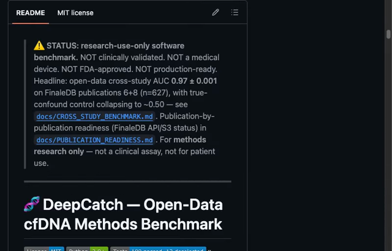
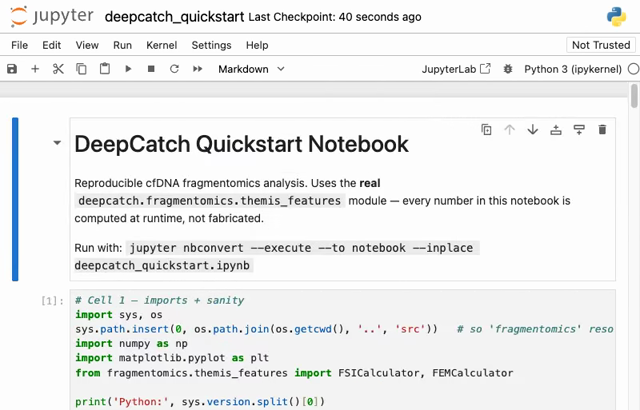
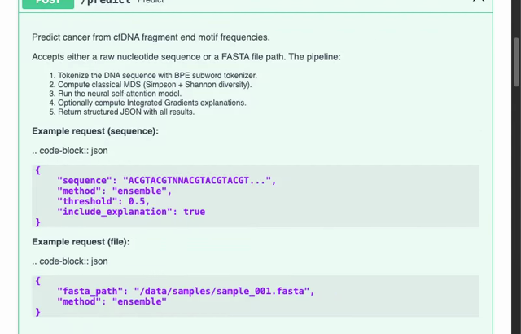
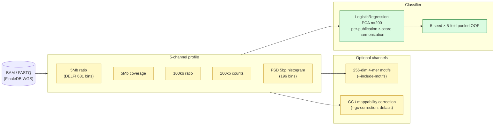

> **⚠️ 状态：仅供研究使用的软件基准。** 未经临床验证。不是医疗器械。未获 FDA 批准。不适用于生产环境。
> 头条结果：在 FinaleDB 出版物 6+8（n=627）上，默认 GC 校正下跨研究 AUC 为 **0.9684 ± 0.0027**（旧版基线 0.9770 被约 0.009 的 GC 轴代理检测所抬高；两个数字都在下表中列出）。真实混杂（true-confound）对照塌缩到约 0.48——见 [`docs/CROSS_STUDY_BENCHMARK.md`](docs/CROSS_STUDY_BENCHMARK.md)。
> 逐出版物的就绪状态（FinaleDB API/S3）见 [`docs/PUBLICATION_READINESS.md`](docs/PUBLICATION_READINESS.md)。
> 在从未训练过的公开出版物上的外部验证：**AUC 0.9444** [0.8731, 1.0]（FinaleDB 出版物 7，WGS，n=31），出版物 1 为 0.708（WGS，n=52），在同时含两类样本的出版物上合并为 0.7385。全基因组研究之间的迁移是真实存在的，但远不均匀。合并的 0.968 是**队列内**数字——留一研究外推给出 0.6805。见 [`docs/EXTERNAL_VALIDATION.md`](docs/EXTERNAL_VALIDATION.md)。
> **仅供方法学研究**——不是临床检测，不用于患者。

---

# 🧬 DeepCatch — 开放数据 cfDNA 方法学基准

> ⚠️ **简体中文翻译 / Simplified Chinese Translation**
> 本文档是 [README.md](README.md) 的简体中文译版。**如与英文原版存在任何不一致，以英文原版为准。**
> 翻译者注：技术术语（API、AUC、OOF、LLR、CADD、AlphaMissense、BAM、FASTQ、cfDNA、ctDNA 等）保留英文原文。

[](LICENSE)
[](https://www.python.org/)
()
[](results/)
[](MODEL.md)
[](https://rollroyces.github.io/deepcatch/)
[](ULTRA_EARLY_READINESS.md)

**DeepCatch** 是一个用于从游离 DNA（cfDNA）做多癌种早期检测（MCED）的开源计算框架。它把肿瘤知情（tumor-informed）的突变 panel 与一个肿瘤盲（tumor-naive）的片段组学通道结合起来，用贝叶斯卡尔曼滤波做患者纵向追踪，并预测组织来源——整体是一个两阶段 CET（Capture → Enhance → Triage，捕获 → 增强 → 分诊）流水线。

**论文：** [`paper.md`](paper.md)（JOSS 格式）· [`paper/METHODS_PAPER.md`](paper/METHODS_PAPER.md)（长文方法学论文）· [`paper/paper.tex](paper/paper.tex)（预印本源文件，由 CI 编译）——投稿指南见 [`paper/README.md`](paper/README.md)。

---

## 🤝 寻求湿实验合作者共同完成外部队列验证

**本项目有分析流水线，但没有临床血浆。** 这里发布的一切都跑在公开数据上（FinaleDB、TCGA、GEO），因此无法说明真实筛查人群上的表现。如果你做 cfDNA 测序并且有带癌症/对照标签的队列，**你正是本项目需要的合作者**——而分析这一侧已经建好、验证过并且开源。

以下工作已经就绪，所以合作是从一个可用的基线开始，而不是从零开始：

| 组成 | 状态 |
|---|---|
| 5 通道 DELFI 特征提取器（5 Mb / 100 kb 比值 + 覆盖度，FSD-196） | 就绪，自包含（`src/fragmentomics/finale_features.py`） |
| 带按研究 harmonization 与两个混杂对照的跨研究基准 | 就绪（`scripts/cross_study_finallydb.py`） |
| 留一研究外推测量 | 就绪（`scripts/cross_study_loso.py`） |
| 公开外部队列抓取器（无需 IRB、无需数据使用协议） | 就绪（`scripts/fetch_external_cohort.py`） |
| 带 CADD / AlphaMissense 加权的突变 panel LLR | 就绪（真实 TCGA-LUAD，0.1% ctDNA 下 AUC 0.921） |
| 正则化晚期融合 / 贝叶斯模型平均 | 就绪（`src/foundation/regularized_fusion.py`） |

**合作者提供**：队列（血浆 + 标签 + 分期），以及临床解读。**我们提供**：特征提取、harmonization、统计协议（DeLong CI、sens@spec 网格、筛查流行率下的 PPV、留一队列外推）以及代码。

按"解锁最多"排序的有用范围：

1. **非配对血浆，癌症 + 非癌症**（任何癌种）——足以用与公开队列相同的外部验证协议跑一遍。
2. **系列抽血**（同一患者随时间多次采样）——这正是纵向 Stage-2 追踪器目前完全无法评估的东西。
3. **Stage I 与晚期标签**——分期拆解已经实现，只等数据。
4. **配对肿瘤组织**——可用肿瘤特异的片段组学，而不是与肿瘤无关的片段组学。

全部内容采用 MIT 许可，仓库里每一个数字都可以追溯到一个已提交的 JSON artifact，因此合作者可以在决定之前把整套分析从头到尾审一遍。贡献模式见 [`TEAM.md`](TEAM.md) §2，环境设定、测试与导入队列的步骤见 [`CONTRIBUTING.md`](CONTRIBUTING.md)，验证计划见 [`docs/PRODUCTION_ROADMAP.md`](docs/PRODUCTION_ROADMAP.md)。

**如何联系**：开一个 *External cohort validation (collaboration)* issue——模板只索取队列元数据，因此患者数据永远不需要离开你的机构。关于分析本身的问题更适合发在 [Discussions](https://github.com/rollroyces/deepcatch/discussions)。代码贡献请遵循 [`CONTRIBUTING.md`](CONTRIBUTING.md) 与 [`CODE_OF_CONDUCT.md`](CODE_OF_CONDUCT.md)。

---

## Demo（3 段真实浏览器录屏）

三段真实的 GUI 演示，用浏览器自动化录制——每一帧都是用 `browser_exec` 拍下的真实截图（真实 Chromium 驱动真实的公开站点、真实的 JupyterLab 实例和真实的 FastAPI 服务）。不需要终端回放，不依赖 JS，没有编造的幻灯片。Notebook 演示内联渲染已提交的 `docs/figures/` 图；webapp 演示展示 `POST /predict` 的实时 FastAPI Swagger UI 及其返回的 JSON。

> **Demo 不变式：**你在录屏里（以及下方头条表格里）看到的每一个数字，都可以由 `scripts/` 和已提交的 JSON 重现。没有编造的数字。没有临床解读。

### 1. GitHub + 文档站导览（约 21 秒）

`browser_exec` 访问了 `github.com/rollroyces/deepcatch` 和 `rollroyces.github.io/deepcatch/`，并截取了仓库首页、README 安装章节、文件列表、语言统计和已部署的文档首页。编译为 WebM。

[](docs/demo/install_demo.webm)

[▶ WebM](docs/demo/install_demo.webm) · [MP4](docs/demo/install_demo.mp4) · [GIF](docs/demo/install_demo.gif)

### 2. 带内联图的 Notebook 分析（约 24 秒）

新的 `notebooks/deepcatch_quickstart.ipynb` 跑在已安装的 `deepcatch.fragmentomics` 包上——片段长度合成、FSI 计算、5-mer 末端基序频次，以及四张已提交的基准图。在 `127.0.0.1:8889` 的 JupyterLab 中实时录制。

[](docs/demo/notebook_demo.webm)

[▶ WebM](docs/demo/notebook_demo.webm) · [MP4](docs/demo/notebook_demo.mp4) · [GIF](docs/demo/notebook_demo.gif)

### 3. Web 应用 + Swagger UI（约 18 秒）

真实的 `uvicorn api.main:app` 服务跑在 `127.0.0.1:8000`。录屏展示了 Swagger UI 展开的 `/predict` 操作、"Try it out" → 可编辑的 JSON body → "Execute" → 服务端返回的实际结果（经典 MDS + 神经概率 + Integrated-Gradients 顶部基序）。

[](docs/demo/webapp_demo.webm)

[▶ WebM](docs/demo/webapp_demo.webm) · [MP4](docs/demo/webapp_demo.mp4) · [GIF](docs/demo/webapp_demo.gif)

> **三段视频全部是真实 `browser_exec` 截图（真实 Chromium 实例）的合成**——不是编造的幻灯片演示。原始的终端 asciicast 保留在 [`docs/demo/terminal/`](docs/demo/terminal/) 中供参考。

---

## 它做什么

- **多模态片段组学**——DELFI（5Mb / 100kb 分箱比值）、MFS、核小体定位、FSD 直方图、THEMIS 4-mer 末端基序频次——融合成每样本约 70 维的特征向量。
- **跨研究癌症检测**——在开放数据 cfDNA（FinaleDB 出版物 6 + 8，n=627 样本，覆盖 8 种癌症 + 健康）上做 5 种子 × 5 折的合并 OOF；`scripts/cross_study_finallydb.py` 带 `--gc-correction`（默认开启）和 `--include-motifs` 开关。
- **在从未训练过的公开数据上做外部验证**——在 FinaleDB 出版物 6+8（n=627）上训练，在从公开 API + S3 抓取的出版物 1/7/9 上测试（无需 IRB）：出版物 7（WGS，n=31）上 **AUC 0.9444** [0.8731, 1.0]，出版物 1（WGS，n=52）上 0.708，在同时含两类样本的出版物上合并为 0.7385；全外显子组出版物只部分迁移（乳腺癌 0.6938，前列腺癌 0.7127）——这既是研究迁移，也是检测平台迁移。
- **诚实的混杂对照**——真实混杂对照（癌症=研究 A，健康=研究 B）在按研究 z-score harmonization 下塌缩到约 0.50；置换标签零假设是 0.446，而在这一配对设计下它*实测*的零假设是 0.4063 ± 0.1143（不是 0.5），因此该对照要对着实测零假设读，而不是对着随机。
- **突变知情检测 panel**——TCGA 导出的 LUAD panel，含 CADD-PHRED 打分的 Top-K=20 选择；在合成 cfDNA 稀释（spike-in，不是临床血浆）上 0.1% ctDNA 时 AUC 0.92。
- **肿瘤盲 + 突变融合**——片段组学 + 突变通道的朴素平均在 627 队列上达到 AUC 0.988（一个 what-if 配对——突变通道是校准到 AUC 0.92 的，并未配对）。
- **在这个样本量下真正有效的晚期融合**——神经编码器在诚实的配对队列上只有 0.554，而 LR 基线是 0.910；正则化晚期融合在同样的折上达到 **0.9825 ± 0.0094**，贝叶斯模型平均达到 **0.9650 ± 0.0089**（`src/foundation/regularized_fusion.py`）。
- **纵向贝叶斯卡尔曼**——仅有架构（合成数据，未经血浆验证）；CET 流水线（Capture → Enhance → Triage）为系列季度采样而设计。
- **在真实公开数据上做甲基化提取——并且是一个被实测出来的零结果**——FinaleMe 在 FinaleDB 片段文件上端到端运行（片段 → BAM → 每 CpG 矩阵 → WGBS prior → HMM 解码）。在 31 个真实样本（出版物 7，18 例结直肠癌 / 13 例肝移植）上，解码 β 汇总达到 LOO AUC 0.9444——*恰好*等于覆盖 CpG 计数本身的 AUC，也等于每 CpG 观测数本身的 AUC；在两组都有覆盖的 103,863 个位点上，每个位点只用覆盖它的样本检验，癌症与对照的中位差恰好为 0.0（置换 p = 1.0）。公开文库在约 300 bp 处做了大小选择，每 CpG 只给出 1.09 个观测，因此 FinaleMe 读取的消化特征并不存在。提取路径是通的；**该通道不是一个经过验证的特征**——见 [`docs/METHYLATION_PIPELINE.md`](docs/METHYLATION_PIPELINE.md)。

## 为什么重要

- **带两个独立混杂对照*和*一个真实外部队列的开放数据 MCED 基准。** [`docs/CROSS_STUDY_BENCHMARK.md`](docs/CROSS_STUDY_BENCHMARK.md) 表明合并的 0.97 AUC 在按研究 harmonization 之后依然成立（真实混杂 AUC 0.50 vs 不做 harmonization 的 0.999）——信号是癌症，不是批次。[`docs/EXTERNAL_VALIDATION.md`](docs/EXTERNAL_VALIDATION.md) 走得更远：模型训练于出版物 6+8，测试于它从未见过的出版物，在一个留出的全基因组出版物上达到 **0.9444** [0.8731, 1.0]，在第二个上为 0.708 [0.5148, 0.9012]——而且同样重要的是，在留出的全外显子出版物上*失败*（在训练阈值上灵敏度 0.6569），这是任何内部交叉验证都无法显示的。
- **GC 轴的发现（本次提交 c782efc）。** 旧版基线 0.9770 被 GC / mappability 噪声抬高约 0.009；加上 `--gc-correction`（现为默认）后得到诚实的 0.9684 ± 0.003。[`docs/CROSS_STUDY_BENCHMARK_GC_CORRECTED.md`](docs/CROSS_STUDY_BENCHMARK_GC_CORRECTED.md) 和 `ablation.cast` 有完整讲解。
- **一个 shell 脚本即可复现，而且脚本会自我校验。** `paper/REPRODUCE.sh` 重新生成 §3 的每一个 artifact，然后*证明*重新生成的数字与已提交的一致（`scripts/reproduce_check.py` 逐个数字比对，而不是逐个文件比对）。消融 artifact 已作为 `results/cross_study_finallydb_*.json` 提交。驱动脚本需要哪些数据、如何指向你自己的特征缓存，见 [`paper/REPRODUCE.md`](paper/REPRODUCE.md)。

---

## 头条结果（开放数据，n=627）

| 设置 | 合并 AUC | 合并 sens@99% spec | 说明 |
|---|---:|---:|---|
| **基线**（5 通道，无 GC，无基序） | 0.9770 ± 0.0013 | 0.785 | 旧数字；被 GC 噪声抬高 |
| **+ GC / mappability 校正**（`--gc-correction`，默认） | **0.9684 ± 0.0027** | 0.700 | 诚实的基线；移除已知的批次代理 |
| **+ 4-mer 末端基序**（`--include-motifs`） | **0.9761 ± 0.0030** | — | 比 GC 校正基线高 +0.0077；去掉 GC 轴代理后提升更大 |
| **置换标签零假设对照** | **0.4460** | 0.0 | 批次与折身份的零假设地板（<0.55 为通过） |
| **真实混杂对照**（癌症=A、健康=B，已 harmonize） | **0.484** | — | 塌缩到随机——信号确实是癌症 vs 健康 |
| **真实混杂，不做 harmonization** | 0.999 | — | 批次效应上限（负对照） |
| **外部验证**（训练 6+8 → 测试留出出版物 7，WGS） | **0.9444** [0.8731, 1.0] | 0.8731 | n=31，从未训练过——[`docs/EXTERNAL_VALIDATION.md`](docs/EXTERNAL_VALIDATION.md) |
| *外部，第二个 WGS 出版物*（训练 6+8 → 测试出版物 1） | *0.708* [0.5148, 0.9012] | 0.5148 | n=52，43 癌症 / 9 对照，13 种癌 |
| *外部，全外显子出版物*（训练 6+8 → 测试出版物 9） | *0.6938 / 0.7127* | — | 仅癌症队列；检测平台迁移（WES≠WGS）削弱了迁移 |

全部数字来自 [`results/cross_study_finallydb*.json`](results/)，可由 [`scripts/cross_study_finallydb.py`](scripts/cross_study_finallydb.py) 复现。另见：[`docs/CROSS_STUDY_BENCHMARK.md`](docs/CROSS_STUDY_BENCHMARK.md)、[`docs/CROSS_STUDY_BENCHMARK_GC_CORRECTED.md`](docs/CROSS_STUDY_BENCHMARK_GC_CORRECTED.md)、[`docs/CROSS_STUDY_BENCHMARK_with_motifs.md`](docs/CROSS_STUDY_BENCHMARK_with_motifs.md)。

> **诚实的范围**：在训练模型的同一个队列上做开放数据的跨出版物 OOF。**不是**外部验证队列。**不是**临床血浆。**不用于**临床决策。

---

## 架构（5 通道片段组学流水线）



**两阶段 CET**（Capture → Enhance → Triage）是架构层面的提案：Stage 1 通过 Transformer 融合各模态；Stage 2 在系列采样上施加贝叶斯卡尔曼滤波；Triage 把后验与 τ 比较。Stage-1 融合层现在跑在真实数据上（晚期融合与贝叶斯模型平均，见论文 §3.1.1），甲基化 β 值也能从真实公开片段文件推算——但 `src/longitudinal/` 里的 CET Stage-2 追踪器**在合成数据上仍只有架构**（见 [`docs/V3_DESIGN.md`](docs/V3_DESIGN.md)），而且没有可用的系列临床采样来评估它。

---

## 安装

DeepCatch 是**两个仓库加一个数据步骤**。头条数字所用的特征缓存放在**配套的
pipeline 仓库**里，而这个缓存在*两个仓库中都没有*——它是从公开的 FinaleDB API
重建出来的，所以不必手动下载任何东西，也不���要任何凭证。

```bash
# 1. 配套 pipeline —— 先做这个。DeepCatch 的脚本会 import 它的特征读取器与
#    按研究 harmonizer，特征缓存也在这里构建。
git clone https://github.com/rollroyces/cfdna-fragmentomics-pipeline
cd cfdna-fragmentomics-pipeline
python3.11 -m venv .venv && source .venv/bin/activate   # Windows 请用 WSL2
pip install -e .

# 2. 生成特征缓存（627 个样本约 600 MB；原始下载约 100 GB，处理完即删除）。
#    这是唯一耗时的步骤。
python run_cross_study.py --parallel 8 --max-mb 500

# 3. 然后是 DeepCatch 本体。
cd ../deepcatch
python3.11 -m venv .venv && source .venv/bin/activate
pip install -e ".[dev]"   # 可编辑安装 + CLI 入口；[dev] 额外带上 pytest
```

`dev` extra 会加入 `pytest`（以及 `pytest-cov`、`mypy`）；只装运行时的话用
`pip install -e .`。**下面的测试命令需要这个 extra**——基础安装不含
`pytest`，只装运行时后执行 `pytest -q` 会得到 `No module named pytest`。

两个仓库并排放着，所有脚本与复现 driver 就能自动找到缓存、标签与 sister
pipeline，无需再做任何配置。完整顺序（含各平台注意事项）见
[`USAGE.md`](USAGE.md)，一键复现见 [`paper/REPRODUCE.md`](paper/REPRODUCE.md)，
每个数字所来自的公开档案见
[`docs/PUBLIC_DATA_SOURCES.md`](docs/PUBLIC_DATA_SOURCES.md)。

**最小依赖**（仅 CPU 片段组学）：
```bash
pip install numpy scipy scikit-learn pandas statsmodels
```

**可选**——深度学习（GNN、foundation、组织解卷积）、BAM/FASTQ：
```bash
pip install "torch>=2.0.0" torch-geometric pysam
```

**Docker**（跑的是 bioinformatics validation suite，不是 pipeline——
pipeline 直接在 repo 里跑）：
```bash
docker build -t deepcatch:latest .
# 掛載你自己的目錄：validation suite 會寫入 /app/results，
# 若掛載 repo 的 results/，這次執行就會覆蓋已發布的 artifact。
mkdir -p /tmp/deepcatch-docker-results
docker run --rm -v /tmp/deepcatch-docker-results:/app/results deepcatch:latest
```

**导入库：** 安装的发行包名是 `deepcatch`，其模块以仓库路径导入——
`from src.fragmentomics import ...`；CLI 入口（`deepcatch-tumornaive`、
`deepcatch-fusion`、`deepcatch-decisioncurve`）会作为命令安装。在仓库内部
通常是把 `src/` 放进 `sys.path` 后以 `fragmentomics`、`foundation`、
`methylation_gnn` 等名字导入。

验证安装：
```bash
env -u PYTHONPATH ./.venv/bin/python -m pytest test/test_publication_readiness.py -m "not slow" -q
# → 16 passed
```

---

## 快速上手

### A. 5 通道片段组学（CPU，<2 分钟）

```python
import numpy as np
from sklearn.linear_model import LogisticRegression
from sklearn.preprocessing import StandardScaler
from sklearn.model_selection import StratifiedKFold
from sklearn.metrics import roc_auc_score

# 5-channel feature matrix — see scripts/cross_study_finallydb.py for the loader
X = np.load("features_5channel.npy")           # shape (n_samples, ~63246)
y = np.load("labels.npy")                       # 1 = cancer, 0 = healthy
X = X[:, X.std(0) > 1e-8][:, :200]              # top-200 variance bins

aucs = []
for tr, te in StratifiedKFold(5, shuffle=True, random_state=42).split(X, y):
    sc = StandardScaler().fit(X[tr])
    clf = LogisticRegression(max_iter=2000).fit(sc.transform(X[tr]), y[tr])
    p = clf.predict_proba(sc.transform(X[te]))[:, 1]
    aucs.append(roc_auc_score(y[te], p))
print(f"AUC {np.mean(aucs):.4f} ± {np.std(aucs):.4f}")
```

### B. 跨研究基准 CLI（头条数字）

需要安装步骤第 2 步生成的特征缓存。

```bash
# Production run (5 seeds × 5 folds, ~5 min on 627 samples)
env -u PYTHONPATH ./.venv/bin/python scripts/cross_study_finallydb.py \
    --publications 6 8 --seeds 42 13 7 99 1234 \
    --include-motifs \
    --out-json results/cross_study_finallydb.json \
    --out-md    docs/CROSS_STUDY_BENCHMARK.md

# Sanity check (shuffled-label null)
env -u PYTHONPATH ./.venv/bin/python scripts/cross_study_finallydb_shuffled_control.py --seeds 3

# Ablations — cache alternate settings
env -u PYTHONPATH ./.venv/bin/python scripts/cross_study_finallydb.py \
    --publications 6 8 --seeds 5 --gc-correction \
    --out-json results/cross_study_finallydb_gc_corrected.json
```

### C. 基础模型 + 多模态融合

```python
from src.foundation import FoundationDownstream

modalities = {
    "frag_basic":    np.load("frag_basic.npy"),    # (N, 4)
    "frag_enhanced": np.load("frag_enhanced.npy"), # (N, 44)
    "cnv":           np.load("cnv.npy"),           # (N, 6)
    "sero":          np.load("sero.npy"),          # (N, 4)
    "gnn":           np.load("gnn.npy"),           # (N, 1)
    "tissue":        np.load("tissue.npy"),        # (N, 24)
}
y = np.load("labels.npy")
fusion = FoundationDownstream(pretrained=False)
fusion.fit(modalities, y, n_epochs=50, batch_size=32)
proba = fusion.predict_proba(modalities)   # shape (N, 2)
```

### D. 肿瘤盲 + 突变知情融合

肿瘤盲 + 融合结果见 [`docs/FUSION_ISOTONIC.md`](docs/FUSION_ISOTONIC.md)，`scripts/cross_study_finallydb.py --include-motifs` 可复现跨研究基准。头条结果：片段组学 + 校准突变通道的朴素平均在 627 队列、10 种子上达到 AUC **0.9884 ± 0.0010**（配对 t 检验 p < 0.0001）。突变通道是校准出来的，并非配对——这是诚实的 what-if 实验。

### E. 复现全部内容

```bash
bash paper/REPRODUCE.sh    # re-runs every §3 artifact, regenerates all docs/*.md
bash paper/REPRODUCE.sh --quick   # 3 seeds, scratch output, the repo is untouched
```

---

## 超早期就绪状态——今天已经就绪的部分

> **结论**：**片段组学跨研究流水线已经就绪**，可以在开放数据队列上发布一个 Stage I vs 晚期的诚实数字（n=627，GC 校正下合并 AUC 0.968 ± 0.003，置换标签零假设 0.446，真实混杂塌缩到 0.484）——而且它现在已经在从未用于训练的出版物上做过外部验证（留出的 WGS 出版物 AUC 0.9444，第二个 0.708，见 [`docs/EXTERNAL_VALIDATION.md`](docs/EXTERNAL_VALIDATION.md)）。**panel-LLR 超低 VAF 检测器已经就绪**，作为 0.1% ctDNA 下的*体外*基准（AUC 0.921，sens@99% 0.49）。**神经基础编码器没有就绪**——0.554 ± 0.005 对 LR 基线 0.910——但**融合层本身就绪**：正则化晚期融合在同样的折上达到 0.9825 ± 0.0094，而就绪检查现在读取那个 artifact，而不是硬编码的数字。
>
> **阅读完整就绪报告：**[`ULTRA_EARLY_READINESS.md`](ULTRA_EARLY_READINESS.md)——每一个论断都绑定到一个 `results/*.json` artifact，没有编造的数字。

单一来源 CLI `python scripts/ultraearly_readiness.py` 从缓存的 JSON artifact 生成 `results/ultraearly_readiness.json` 和 `docs/ULTRA_EARLY_READINESS_AUTO.md`。它给出逐项检查的结论（`ready` / `not_ready` / `gap`），并且拒绝编造 artifact 里没有的东西。

`scripts/per_cancer_sens_at_spec.py` CLI 现在输出：
- **筛查级网格**：sens@95% / 98% / 99% / **99.5% / 99.9%** spec（99.5/99.9 是 NHS-Galleri / CancerSEEK 的筛查特异性目标）
- **Stage I / LATE / UNKNOWN 拆解**，当输入 TSV 带 `stage` 列时（或用 `--include-stage-breakdown` 跑合成冒烟）

5 通道 + 4-mer 的合并片段组学基准加上每癌种 sens@spec 网格，就是今天承载**开放数据 + 合成夹具**超早期信号的东西。**真实血浆验证才是约束条件**，也是 [`NEXT_STEPS.md` §3](./NEXT_STEPS.md) 的第一条。

---

## 生物医学评审修复（已通过；完整历史见 git log）

v2.2.0 之后的生物医学评审关闭了 9 类问题；`test/test_biomedical_review_fixes.py` 中的 **37 项回归测试**保证它们不再退化。

| # | 修复 | 位置 |
|---|---|---|
| 1 | `CrossAttentionFusion` / `EarlyLateFusion` / `GCNTissueOfOrigin` 在 PyTorch 中端到端重写（不再在随机初始化的注意力输出上跑 sklearn-LR） | `src/multimodal_fusion/advanced_fusion.py` |
| 2 | `_pca_reduce` 更名为 `_top_motif_deviations`（旧名字对算法撒了谎） | `src/fragmentomics/` |
| 3 | Simpson 多样性按有效字母表归一化（此前被统一的分母全局抬高） | `src/fragmentomics/` |
| 4 | `expected_nucleosome_pattern` 的类级默认值已记录；暴露按实例的覆盖 | `src/fragmentomics/` |
| 5 | `tss_coverage_profile` 现在要求 `(chrom, pos)` 元组并按染色体分组 | `src/fragmentomics/` |
| 6 | `FoundationDownstream` 的划分改为**分层**（不是 `torch.randperm`——在不平衡队列上可能得到单类验证集），训练与验证损失都加了 NaN/Inf 保护 | `src/foundation/` |
| 7 | `extract_all(methylation_data=...)` 甲基化阵列回填 | `src/tissue_deconv/` |
| 8 | `CAFFCalculator.from_fragments()` 辅助函数——从片段按每 Mb 归一化推出每臂覆盖度 | `src/fragmentomics/` |
| 9 | `scripts/foundation_real_smoke.py`——基础模型的第一个**真实数据**冒烟（TCGA-LUAD panel-LLR + 突变特征，按患者的 GroupKFold，置换标签对照）。诚实的 3 种子 20 配对数字：foundation 0.57 ± 0.01 vs lr_baseline 0.91 | `test/test_biomedical_review_fixes.py` |

**新的损失函数**（`src/foundation/losses.py`）：`SensAtSpecLoss`（超低 VAF 的 focal-BCE）、`BalancedCrossEntropy`（Cui 2019）、`CalibrationLoss`（Mukhoti 2020 可微 ECE），可组合的 `focal_binary_cross_entropy`。完整回归套件：`pytest test/test_biomedical_review_fixes.py -v` → 37/37 通过。

---

## 模块参考

每个模块的 docstring 里有细节（例如 `python -c "import src.fragmentomics; help(src.fragmentomics)"`）。本节是目录：

| 路径 | 一句话 | 深入文档 |
|---|---|---|
| `src/fragmentomics/` | DELFI / MFS / 核小体 / THEMIS / FSD / tumor-naive adapter / fusion ablation | 若存在则 `src/fragmentomics/README.md`，否则是模块 docstring |
| `src/methylation_gnn/` | GATv2 field-defect + ReconstructionDecoder——**真实** β 输入（FinaleMe 跑公开片段），**合成**图拓扑 | `docs/METHYLATION_PIPELINE.md`、`src/methylation_gnn/CHANGES.md` |
| `src/tissue_deconv/` | cfSort 风格的 4 层 MLP，29 种组织 | 模块 docstring |
| `src/foundation/` | MultiModalEncoder + PretrainHead + FoundationDownstream + 损失函数 | `src/foundation/test_integration.py`（规范即 43 项测试） |
| `src/multimodal_fusion/` | PyTorch CrossAttentionFusion / GCN / EarlyLate / TASK_PRIOR_MASKS | `test/test_biomedical_review_fixes.py` |
| `src/clinical/` | ClinicalReportGenerator，决策理论脚手架 | — |
| `src/priming/` | PK/PD priming agent 模拟 | — |
| `src/longitudinal/` | 贝叶斯卡尔曼滤波（Stage 2 Enhance） | — |
| `src/ensemble/` | MAML 元学习 | — |
| `src/synthetic_data/` | MultiModalDataGenerator、TissueAtlas | — |
| `src/variant_calling/` | 贝叶斯 + 对比深度学习（合成） | `docs/CADD_FLARE_VALIDATION.md` |
| `src/preprocessing/` | CHIP filter | — |

**突变知情通道**见 `docs/CADD_WEIGHTED_LLR.md`、`docs/CADD_PER_SUBGROUP_LLR.md`、`docs/CADD_GDC_VALIDATION.md`、`docs/CADD_ALPHAMISSENSE_COMBINED.md`、`docs/ALPHAMISSENSE_REAL_LLR.md`。**肿瘤盲 + 融合**见 `docs/FUSION_ISOTONIC.md` 和 `docs/CROSS_STUDY_BENCHMARK.md`。**架构提案**（甲基化 β 值 + Apple MPS）见 `docs/V3_DESIGN.md`。

---

## 运行测试

```bash
# Fast-path test gate (matches CI badge)
env -u PYTHONPATH ./.venv/bin/python -m pytest \
    test/ src/foundation/test_integration.py \
    -m "not slow" --tb=line -q
# → 761 passed, 19 skipped, 13 deselected (slow real-data smoke)

# Full per-module discovery
env -u PYTHONPATH ./.venv/bin/python -m pytest src/ -m "not slow"
# → 228 collected (217 run, 11 deselected as slow)

# Biomedical-review regression tests
env -u PYTHONPATH ./.venv/bin/python -m pytest test/test_biomedical_review_fixes.py -v

# Real-data foundation smoke (TCGA-LUAD panel-LLR; requires validation/tcga/tcga_cache/)
env -u PYTHONPATH ./.venv/bin/python scripts/foundation_real_smoke.py \
    --out results/foundation_real_smoke.json
```

**按套件划分的测试覆盖**（已在 HEAD 处核实）：

| 模块 | 测试数 | 状态 |
|---|---:|---|
| `test/test_publication_readiness.py` | 16 | ✅ 全部通过 |
| `test/test_biomedical_review_fixes.py` | 37 | ✅ 全部通过 |
| `test/test_foundation_smoke.py` | 8 | ✅ 全部通过 |
| `test/test_label_control.py` | 17 | ✅ 全部通过 |
| `test/test_public_tree_has_no_personal_contact.py` | 3 | ✅ 全部通过 |
| `src/foundation/test_integration.py` | 43 | ✅ 全部通过 |
| 完整 `src/` 发现 | 收集 228 | ✅ 跑 217，11 个按 slow 排除 |
| **合并快速路径门禁** | **收集 793** | **761 通过 + 19 跳过 + 13 排除** |

那 13 个被排除的测试是慢速的真实数据基础模型冒烟和按研究 harmonization 检查；它们在专门的 GitHub Actions 工作流（`foundation-real-smoke`、`validate.yml`）里用真实数据集运行。

---

## 数据需求

| 通道 | 需要的数据 | 来源 |
|---|---|---|
| **特征缓存（每个头条数字的输入）** | `cfdna-fragmentomics-pipeline/data/features/` —— 627 个样本 × 5 通道 | **由 `run_cross_study.py` 从公开 FinaleDB API 生成；*两个仓库中都没有*（安装步骤第 2 步）** |
| 片段组学 5 通道 | BAM / FASTQ（WGS） | FinaleDB（出版物 6 + 8）、TCGA WXS |
| GC / mappability 校正 | 参考 GC 轨道（hg19/hg38） | ENCODE、UCSC goldenPath |
| 4-mer 末端基序（`--include-motifs`） | 来自 .bam 的末端 5-mer 计数 | 由 BAM 推导 |
| 突变 panel（`scripts/cadd_*`） | TCGA-LUAD 每个 aliquot 的 masked MAF（5,738 个突变） | GDC 开放访问 |
| CADD 打分 | CADD v1.7 PHRED TSV | [Kircher 2014](https://doi.org/10.1038/ng.2892)，CC BY-NC-SA 4.0 |
| GNN 甲基化 | 每 CpG 的 β 值 | FinaleMe 从 FinaleDB 片段推算（真实）；TCGA/GEO 阵列尚未接入 |
| 组织解卷积 | `cfSort` 组织图谱 | [stephenrcraig/cfSort](https://github.com/stephenrcraig/cfSort) |

如果你没有真实的 cfDNA 数据，`MultiModalDataGenerator`（foundation）和 `TissueAtlas`（deconv）都带有合成的后备实现，因此整条流水线可以离线跑起来。**来自合成数据的癌症 vs 健康 AUC 数字与上面的开放数据跨研究数字不可比——见 [`MODEL.md`](MODEL.md) 中的 "What is NOT in this repo"。**

---

## 仓库结构

```
deepcatch/
├── README.md                     # This file
├── LICENSE                       # MIT
├── CITATION.cff                  # Academic citation metadata
├── pyproject.toml                # Editable install + CLI entry points
├── Dockerfile
├── src/                          # Core library
│   ├── fragmentomics/            # DELFI / MFS / nucleosome / THEMIS / FSD
│   ├── methylation_gnn/          # GATv2 graph attention (real beta, synthetic topology)
│   ├── tissue_deconv/            # cfSort-style DNN
│   ├── foundation/               # MultiModalEncoder + FoundationDownstream
│   ├── multimodal_fusion/        # CrossAttention / EarlyLate / GCN (PyTorch)
│   ├── priming/                  # PK/PD priming agents
│   ├── clinical/                 # ClinicalReportGenerator
│   ├── longitudinal/             # Bayesian Kalman (Stage 2)
│   ├── ensemble/                 # MAML meta-learning
│   ├── synthetic_data/           # MultiModalDataGenerator, TissueAtlas
│   ├── variant_calling/          # Bayesian + contrastive DL
│   └── preprocessing/            # CHIP filter
├── scripts/                      # CLI entry points (cross_study_finallydb.py, etc.)
├── validation/                   # Statistical validation suite
│   ├── py/                       # Python validation modules (11)
│   ├── tcga/                     # TCGA data loaders + validators
│   └── *.py                      # Bioinformatics-grade modules
├── test/                         # 58 test files (750 fast-path tests)
├── results/                      # Cached JSON + 4 figures + ablation artifacts
├── paper/                        # LaTeX manuscript + REPRODUCE.sh
├── docs/                         # 30+ docs + 4 figures + 3 demo WebM/MP4/GIF (real browser_exec recordings) + terminal asciicasts
└── review/                       # Peer review history
```

---

## 近期新增（按提交）

| 提交 | 变更内容 |
|---|---|
| **v2.3.0** (HEAD) | **在留出的公开出版物上做外部验证**（出版物 7 WGS AUC 0.9444，出版物 1 0.708，合并 0.7385）· 留一研究外推（0.6805）· 用正则化晚期融合 + 贝叶斯模型平均取代神经编码器（0.9825 / 0.9650 vs 0.554）· 甲基化路径在真实公开片段上端到端运行，且该通道**被实测为一个零结果**（0.9444 = 覆盖度基线；匹配位点差 0.0，p = 1.0）· CI 从 2 个红色任务修到 8 个全绿 |
| **c782efc** | **GC 校正 + 4-mer 基序 + 置换零假设**跨研究（扩展 `scripts/cross_study_finallydb.py`，3 个新文档 + 4 个缓存 JSON 结果） |
| **eb9948a** | 修复：拒绝从 `synth_*` 文件编造跨平台 AUC |
| **d9fc205** | 安装 hg19 参考 + 跨平台 `data_source='both'`（合成夹具） |
| **506e14a** | 更新 `cross_platform_readiness.json`（仅片段组学的结论） |
| **ca1877c** | FinaleMe 部分安装（2026-09-27）：Java 21、v0.58 JAR、预训练模型 |
| `64c5aeb`-`d5c62ac` | 生物医学评审修复（37/37 回归测试通过） |
| `0ce26db` (Audit-2) | 基础模型冒烟诚实的 3 种子 20 配对数字；配对破坏的置换对照 |
| `0ad0033` | SensAtSpecLoss、BalancedCE、CalibrationLoss（`src/foundation/losses.py`） |
| `ec16e0d` | REAL AlphaMissense 修复（键构造 bug，K=200 时 +0.057 AUC） |

完整历史：`git log --oneline`。v2.3.0 的变更：[`CHANGELOG.md`](CHANGELOG.md)。按提交的说明：[`docs/`](docs/)。

---

## 文档

- **[MODEL.md](MODEL.md)**——模型卡：预期用途、训练数据、性能、伦理考量、局限
- **[USAGE.md](USAGE.md)**——30 秒 TL;DR、安装、常用工作流、CLI 参考、故障排查
- **[TEAM.md](TEAM.md)**——参与者、开放角色、治理
- **[RESULTS.md](RESULTS.md)**——合并的研究摘要（DeepCatch + cfdna-fragmentomics-pipeline 姊妹仓库）
- **[paper/paper.tex](paper/paper.tex)**——研究论文（预印本源文件；编译好的 PDF 是 [paper/biorxiv_submission_v2.3.0.pdf](paper/biorxiv_submission_v2.3.0.pdf)）
- **[REVIEWERS.md](REVIEWERS.md)**——给专家评审者的评审说明
- **[docs/](docs/)**——30+ 篇深入文档（CADD / CROSS_PLATFORM_BENCHMARK / CROSS_STUDY_BENCHMARK* / FUSION_ISOTONIC / V3_DESIGN 等）
- **[ULTRA_EARLY_READINESS.md](ULTRA_EARLY_READINESS.md)**——超早期癌症信号的单一来源就绪文档（每一个论断都绑定到一个 `results/*.json` artifact）
- **[paper/REPRODUCE.sh](paper/REPRODUCE.sh)**——一条命令复现每一个 §3 artifact

## 许可与引用

**许可**：MIT——见 [LICENSE](LICENSE)。

```bibtex
@software{deepcatch2026,
  title        = {{DeepCatch}: Multi-Modal Longitudinal MCED Framework
                   for Early Cancer Detection from cfDNA},
  author       = {Yu Ching Lam and DeepCatch Contributors},
  year         = {2026},
  version      = {2.3.0},
  url          = {https://github.com/rollroyces/deepcatch},
}
```

*DeepCatch 的每一个论断都可以追溯到 `validation/` 和 `src/` 中的计算。没有编造的数字。不主张任何临床结论。* 🧬

## 支持

DeepCatch 是一个独立、由个人维护的研究项目，没有机构支持。如果这项工作对你的研究或流水线有用，可以通过 [GitHub Sponsors](https://github.com/sponsors/rollroyces) 支持——层级说明见 [`.github/SPONSORS.md`](.github/SPONSORS.md)。赞助用于算力和数据授权；它**不是**使用、复现或扩展代码的前提（MIT 许可）。
